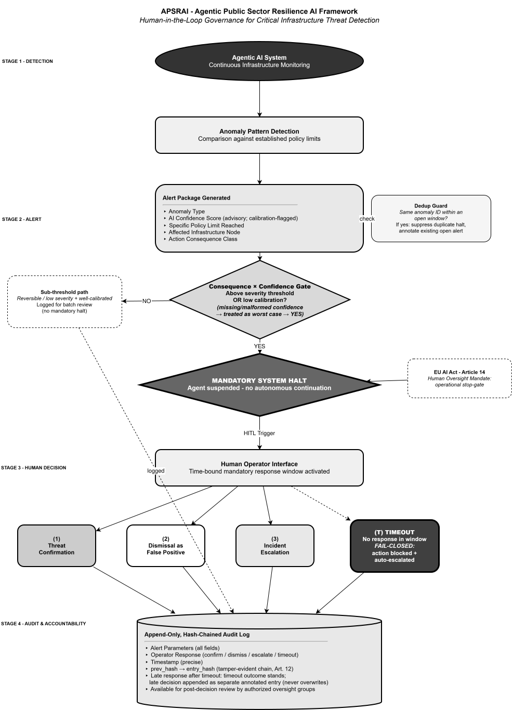

# APSRAI Prototype

**A Python simulation of human-in-the-loop governance for agentic AI threat detection.**

## What this is

This repository contains a working prototype of the APSRAI framework (Agentic Public Sector Resilience AI), developed as part of a Design Science Research study on embedding human oversight into agentic AI systems for critical infrastructure threat detection.

The prototype is not a production system. It is a simulation that demonstrates one specific thing: that a human operator can be made structurally mandatory in an AI-driven decision pipeline, not optional and not advisory, but a hard stop before any consequential action is taken. This operationalizes Article 14 of the EU AI Act, which mandates human oversight for high-risk AI systems but does not specify how to implement it.

The accompanying paper proposes APSRAI as a governance framework. This prototype instantiates that framework as executable code, serving as the demonstration and artifact components of the DSRM methodology used in the study.

## What it demonstrates

The simulation routes synthetic infrastructure events through a four-stage gated pipeline and produces an audit log whose integrity can be independently verified.

1. **Detection.** Each event is checked against a policy limit. If the observed value exceeds the limit, an anomaly is raised and a confidence score is derived. Confidence may be absent when the upstream model fails to emit a usable score.
2. **Alert generation and severity gate.** The anomaly is packaged into a structured alert (anomaly type, confidence, policy limit breached, affected node, consequence class). A severity gate then decides whether the classification triggers a mandatory halt or is logged for batch review. Severity is computed as confidence multiplied by node criticality. A missing or malformed confidence score is treated as worst case and routed to halt. A low-calibration score is routed to halt regardless of magnitude.
3. **Time-bound human decision.** For gated classifications the system halts and the operator must select one of three authorized responses within a defined window: threat confirmation, dismissal as false positive, or escalation. If no response arrives in time, the system fails closed: the pending action is blocked and the alert is auto-escalated to the next oversight tier.
4. **Append-only, hash-chained audit log.** Regardless of outcome, a timestamped record is appended to the log. Each record is chained to its predecessor by a cryptographic hash, so any later alteration, deletion, or reorder is detectable. This provides the tamper-evidence implied by Article 12 of the EU AI Act.

Three boundary conditions keep the gate's state space complete: duplicate classifications carrying the same anomaly identifier within an open window are deduplicated rather than re-halted; a missing confidence score fails safe to halt; and an operator decision arriving after a recorded timeout is appended as a separate annotated entry that never overwrites the timeout outcome.



## Structure

```
apsrai/
  src/
    config.py         parameters: nodes, criticality, thresholds
    detection.py      Stage 1, anomaly detection and synthetic data
    gate.py           Stage 2, alert and consequence x confidence gate
    decision.py       Stage 3, time-bound human decision (fail-closed)
    audit.py          Stage 4, hash-chained log, verification, tamper test
    orchestrator.py   wiring, boundary conditions, deterministic demo
    apsrai.py         CLI entry point
  tests/              behavioural tests, one per paper claim
  outputs/            generated audit log and summary CSV
  pyproject.toml
  README.md
  LICENSE
```

The module layout mirrors the framework's four stages, so each stage in the paper maps to one module.

## How to run it

Python 3.9 or higher. No external runtime libraries are required; the code uses only the standard library. Run from the repository root.

### Run modes

```bash
python src/apsrai.py --demo          # deterministic run, exercises all six behaviours
python src/apsrai.py --simulate      # unattended run, randomised operator decisions
python src/apsrai.py                 # interactive, you act as the operator
python src/apsrai.py --verify        # re-walk and verify the existing chain
python src/apsrai.py --tamper-test   # flip one entry, show the chain detects it
```

The `--demo` run is the one referenced in the paper. It deterministically produces one of each behaviour, so the committed audit log is complete evidence rather than seed-dependent. Two files are written to `outputs/`:

- `apsrai_audit_log.jsonl`: append-only, hash-chained audit log, one JSON record per line
- `apsrai_summary.csv`: flat summary table, one row per logged decision

## What the demo run demonstrates

| Behaviour (paper claim) | Audit-log signature |
|---|---|
| Consequential action, mandatory halt | `gate_decision=halt`, operator confirms |
| Sub-threshold classification, logged without halt | `operator_decision=none_sub_threshold` |
| Missing or malformed confidence, fail safe to halt | `confidence=null`, `gate_decision=halt` |
| Operator timeout, fail-closed and auto-escalate | `operator_decision=timeout` |
| Late decision after timeout, annotated entry | `operator_decision=late_*`, timeout stands |
| Duplicate within open window, suppressed | `operator_decision=duplicate_suppressed` |

## Output format

Each audit log entry contains:

| Field | Description |
|---|---|
| `log_id` | Unique identifier for this log entry |
| `alert_id` | Identifier of the originating alert |
| `anomaly_id` | Identifier of the originating anomaly (used by the dedup guard) |
| `alert_timestamp` | When the alert was generated |
| `node` | Affected infrastructure node |
| `anomaly_type` | Type of anomaly detected |
| `confidence` | AI confidence score, or null when absent |
| `observed_value` | Observed metric value (lets a reviewer reconstruct the anomaly) |
| `policy_limit` | The threshold that was exceeded |
| `severity` | confidence x node criticality, or null when confidence is absent |
| `consequence_class` | `consequential`, `sub_threshold`, `low_calibration`, or `indeterminate` |
| `gate_decision` | `halt` or `log_only` |
| `operator_decision` | The recorded outcome, including `timeout` and `late_*` cases |
| `outcome_note` | Annotation for fail-closed, dedup, and late-response entries |
| `log_timestamp` | When the log entry was written |
| `prev_hash` | Hash of the preceding entry (genesis for the first) |
| `entry_hash` | SHA-256 over the canonical record plus `prev_hash` |

## Audit-log integrity

```
entry_hash = SHA-256( canonical_json(record_without_entry_hash) + prev_hash )
```

`verify_chain()` re-walks the log. A mismatched `entry_hash` reveals an altered record; a mismatched `prev_hash` reveals a deletion or reorder. The `--tamper-test` mode flips one field in a copy of the log and shows that verification flags it.

## Tests

```bash
pip install pytest
pytest -q
```

`pyproject.toml` puts `src` on the path for the test run, so no manual `PYTHONPATH` setup is needed.

Each test asserts one claim from the paper's Artifact Description, so the suite doubles as a claim-to-code checklist.

## Limitations

This prototype demonstrates workflow logic and regulatory alignment. It does not validate detection accuracy, system performance under load, or integration with real infrastructure. The synthetic data is generated, and the confidence score is a simplified ratio rather than the output of a trained model. The thresholds in `config.py` (severity 0.45, calibration floor 0.20, node criticality values) are illustrative parameters chosen to make the demonstration legible; they are not empirically calibrated. Threshold calibration and real-world effectiveness require empirical testing in an active deployment context, which is explicitly outside the scope of this study.

## Regulatory alignment

The four-stage architecture maps to the regulatory instruments evaluated in the accompanying paper:

- **EU AI Act, Article 14.** The mandatory halt in Stage 3 implements the human oversight requirement as an operational stop-gate, including the fail-closed default on operator non-response.
- **EU AI Act, Article 12.** The hash-chained audit log in Stage 4 provides the tamper-evident record-keeping the article implies.
- **ALTAI, transparency criterion.** The alert package in Stage 2 gives the operator full decision context before any action is taken.
- **ALTAI, accountability criterion.** The audit log creates a complete and reviewable record of every AI-influenced classification.
- **CER Directive, oversight capacity.** The decision structure ensures consequential classifications are reviewed by an authorized human operator before any action proceeds.

## How to cite

Please check Zenodo for the current version DOI before citing.

> Salmanov, P. (2026) *APSRAI Prototype.* Zenodo. doi:10.5281/zenodo.XXXXXXX

BibTeX:

```bibtex
@software{salmanov2026apsrai,
  author    = {Salmanov, Parviz},
  title     = {{APSRAI Prototype: Human-in-the-Loop Governance for Agentic AI Threat Detection}},
  year      = {2026},
  publisher = {Zenodo},
  version   = {2.0.0},
  doi       = {10.5281/zenodo.XXXXXXX},
  url       = {https://doi.org/10.5281/zenodo.XXXXXXX}
}
```

## Author

**Parviz Salmanov, MSc**
Research Assistant, Tallinn University of Technology (TalTech)

## License

MIT License. You are free to use, modify, and distribute this code for academic and non-commercial purposes with attribution.
